# Marvel Heroes Omega art mods 
texture pack fan art modifications of item icons , UI , and environments in Marvel Heroes Omega

[VIEW WEBSITE]( https://corvaeoboro.github.io/marvel_heroes_omega_art_mods/ )   | DOWNLOAD = [ALL]( https://raw.githubusercontent.com/CorvaeOboro/marvel_heroes_omega_art_mods/main/00_MODS/ITEM_ALL_20260724.zip )    |          [INSTALL GUIDE]( https://github.com/CorvaeOboro/marvel_heroes_omega_art_mods#install) | [SOURCE]( https://github.com/CorvaeOboro/marvel_heroes_omega_art_mods/archive/refs/heads/main.zip)

[ITEM_DarkRunes]( https://raw.githubusercontent.com/CorvaeOboro/marvel_heroes_omega_art_mods/main/00_MODS/ITEM_DarkRunes_20260724.zip )    | [ITEM_UruReForged]( https://raw.githubusercontent.com/CorvaeOboro/marvel_heroes_omega_art_mods/main/00_MODS/ITEM_UruReForged_20260630.zip ) + [2x ( 80px )]( https://raw.githubusercontent.com/CorvaeOboro/marvel_heroes_omega_art_mods/main/00_MODS/ITEM_UruReForged_2x_20260724.zip )    | [ITEM_ArtifactsArmor]( https://raw.githubusercontent.com/CorvaeOboro/marvel_heroes_omega_art_mods/main/00_MODS/ITEM_ArtifactsArmor_20260724.zip ) + [2x ( 80px )]( https://raw.githubusercontent.com/CorvaeOboro/marvel_heroes_omega_art_mods/main/00_MODS/ITEM_ArtifactsArmor_2x_20260724.zip )    | [ITEM_BattleforgedBaubles]( https://raw.githubusercontent.com/CorvaeOboro/marvel_heroes_omega_art_mods/main/00_MODS/ITEM_BattleforgedBaubles_20260724.zip ) + [2x ( 80px )]( https://raw.githubusercontent.com/CorvaeOboro/marvel_heroes_omega_art_mods/main/00_MODS/ITEM_BattleforgedBaubles_2x_20260724.zip )    | [UI_Item_NoGlassOverlay]( https://raw.githubusercontent.com/CorvaeOboro/marvel_heroes_omega_art_mods/main/00_MODS/UI_Item_NoGlassOverlay_20260630.zip )    |  [PowerNotReady]( https://raw.githubusercontent.com/CorvaeOboro/marvel_heroes_omega_art_mods/main/00_MODS/PowerNotReady_removal.zip ) | [ENV_SinisterLab]( https://raw.githubusercontent.com/CorvaeOboro/marvel_heroes_omega_art_mods/main/00_MODS/ENV_SinisterLab_DarkPurple_20261103.zip )

<table>
<tr>
<td><a href="https://corvaeoboro.github.io/marvel_heroes_omega_art_mods/ITEM/DarkRunes.html">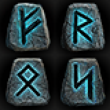</a></td>
<td><a href="https://corvaeoboro.github.io/marvel_heroes_omega_art_mods/ITEM/UruReForged.html">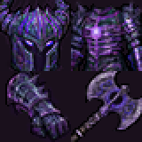</a></td>
<td><a href="https://corvaeoboro.github.io/marvel_heroes_omega_art_mods/ITEM/ArtifactsArmor.html">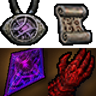</a></td>
<td><a href="https://corvaeoboro.github.io/marvel_heroes_omega_art_mods/ITEM/BattleforgedBaubles.html">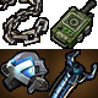</a></td>
<td><a href="https://corvaeoboro.github.io/marvel_heroes_omega_art_mods/ENV/SinisterLab.html">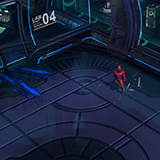</a></td>
</tr>
</table>

## ITEM_DarkRunes
[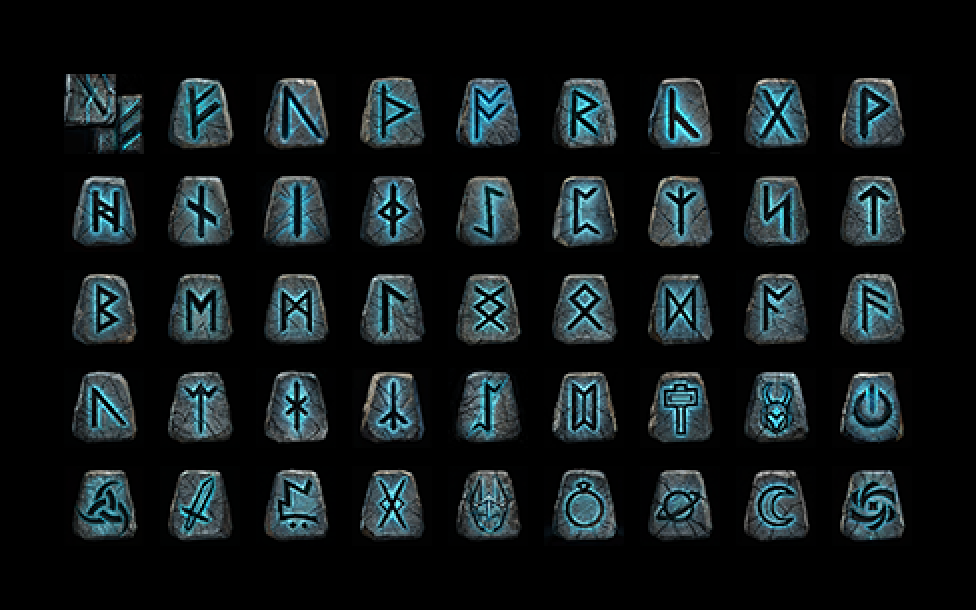](https://corvaeoboro.github.io/marvel_heroes_omega_art_mods/ITEM/DarkRunes.html)

[DOWNLOAD](https://raw.githubusercontent.com/CorvaeOboro/marvel_heroes_omega_art_mods/main/00_MODS/ITEM_DarkRunes_20260724.zip)  | Runes of Asgardian magic carved into basalt stone 

## ITEM_UruReForged
[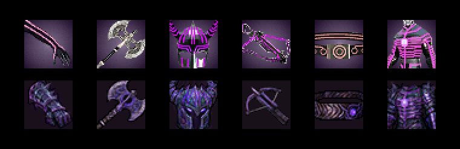](https://corvaeoboro.github.io/marvel_heroes_omega_art_mods/ITEM/UruReForged.html)

[DOWNLOAD ( 40px )](https://raw.githubusercontent.com/CorvaeOboro/marvel_heroes_omega_art_mods/main/00_MODS/ITEM_UruReForged_20260630.zip) | [2x ( 80px )](https://raw.githubusercontent.com/CorvaeOboro/marvel_heroes_omega_art_mods/main/00_MODS/ITEM_UruReForged_2x_20260724.zip) | Nidavellir dwarven Uru metal forged by Asgardian smiths into magic armor

## ITEM_ArtifactsArmor
[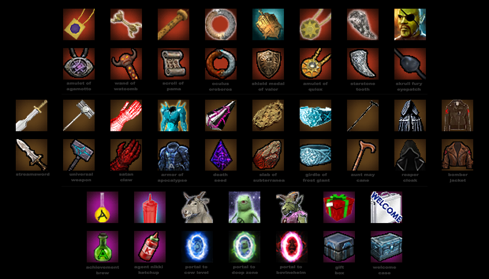](https://corvaeoboro.github.io/marvel_heroes_omega_art_mods/ITEM/ArtifactsArmor.html)

[DOWNLOAD ( 40px )](https://raw.githubusercontent.com/CorvaeOboro/marvel_heroes_omega_art_mods/main/00_MODS/ITEM_ArtifactsArmor_20260724.zip) | [2x ( 80px )](https://raw.githubusercontent.com/CorvaeOboro/marvel_heroes_omega_art_mods/main/00_MODS/ITEM_ArtifactsArmor_2x_20260724.zip) | ancient Artifacts of powers cosmic awakened Armor enchanted by the techno-logical

## ITEM_BattleforgedBaubles
[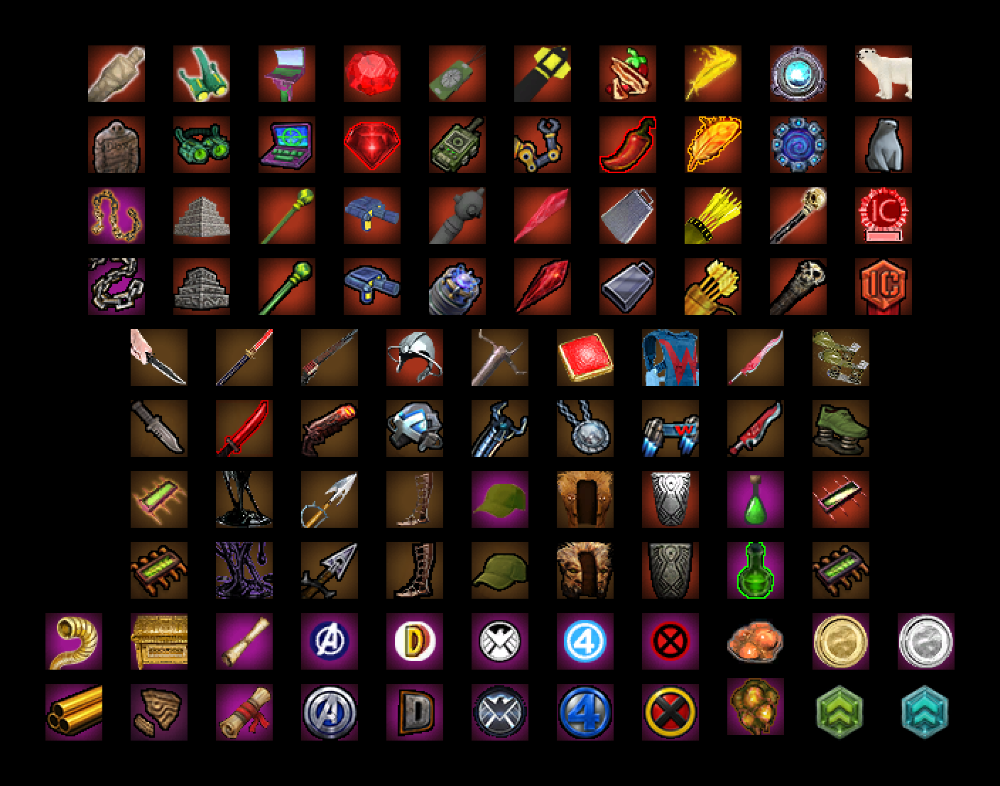](https://corvaeoboro.github.io/marvel_heroes_omega_art_mods/ITEM/BattleforgedBaubles.html)

[DOWNLOAD ( 40px ) ](https://raw.githubusercontent.com/CorvaeOboro/marvel_heroes_omega_art_mods/main/00_MODS/ITEM_BattleforgedBaubles_20260724.zip) | [2x ( 80px )](https://raw.githubusercontent.com/CorvaeOboro/marvel_heroes_omega_art_mods/main/00_MODS/ITEM_BattleforgedBaubles_2x_20260724.zip) | bionicly built Baubles forged in Battles from the beyond 

---

## UI_Item_NoGlassOverlay
[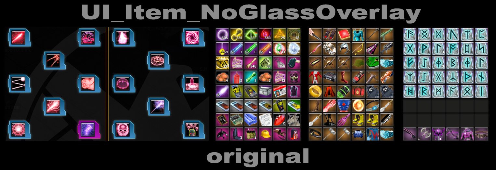](https://corvaeoboro.github.io/marvel_heroes_omega_art_mods/UI/NoGlassOverlay.html)

[DOWNLOAD](https://raw.githubusercontent.com/CorvaeOboro/marvel_heroes_omega_art_mods/main/00_MODS/UI_Item_NoGlassOverlay_20260630.zip)  | removes the "glass" style bevel emboss on item and power icons

## Power Not Ready = hidden
[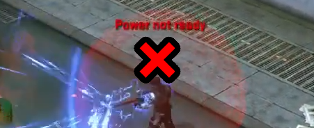](https://corvaeoboro.github.io/marvel_heroes_omega_art_mods/UI/PowerNotReady.html)

[DOWNLOAD](https://raw.githubusercontent.com/CorvaeOboro/marvel_heroes_omega_art_mods/main/00_MODS/PowerNotReady_removal.zip) 
- a locale string replacement client mod to hide the display of "Power not ready" red text and other similar failure messages  

| String                                | ID                   |
| ------------------------------------- | -------------------- |
| `Power not ready`                       | 13079208163413198184 |
| `Not Enough $primarymanabehaviorname2$` | 484996091518715198   |
| `Not Enough $primarymanabehaviorname1$` | 2904019005173597500  |
| `Power not allowed in this area!`       | 3152272457036793101  |
| `Power cannot be used while flying.`    | 5347908306241783053  |
| `That power needs a valid target.`      | 6314264707972531518  |
| `Power not allowed at this location!`   | 2201086116071343363  |
| `You already have that stolen power.`   | 17448350502282396943 |

---

## ENV_SinisterLab
[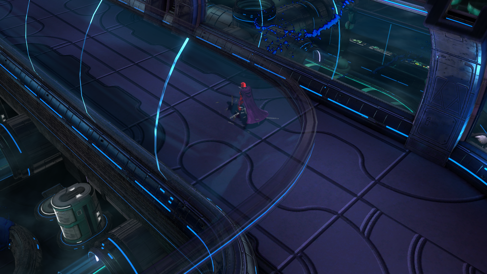](https://corvaeoboro.github.io/marvel_heroes_omega_art_mods/ENV/SinisterLab.html)

[DOWNLOAD](https://raw.githubusercontent.com/CorvaeOboro/marvel_heroes_omega_art_mods/main/00_MODS/ENV_SinisterLab_DarkPurple_20261103.zip) | [UPK version](https://drive.google.com/file/d/1Bwo_cecB8mexd1tmlVJD358Emzh0HXZ1) | the Sinister Lab darkened and non-reflective with wide beveled panel lines

# INSTALL
-  [DOWNLOAD](https://raw.githubusercontent.com/CorvaeOboro/marvel_heroes_omega_art_mods/main/00_MODS/ITEM_ALL_20260724.zip) the ALL pack preset ( uru 2x , runes 1x , artifacts 2x , baubles 2x , UI NoGlass , PowerNotReady ) 
- OR choose specific packs between the 2x ( 80px ) or original ( 40px ) sizes ( or create your own using the [mod_selector](https://github.com/CorvaeOboro/marvel_heroes_omega_art_mods/tree/main/Z_TOOLS/mho_01_mod_selector.py) tool )
- install the .zip of the TexturePack using the [MHO Extended Mod Manager](https://github.com/leeper48/MHO-UPK-Tools) ( or the Krisan Thyme ModManager ) :
  1. click "Install Mod..." , select the downloaded .zip
  2. check the mod ON
  3. click the "Apply Changes" button

# other resources
- MHServerEmu modded github = [MHServerEmu](https://github.com/CorvaeOboro/MHServerEmu)

# LICENCE
free to all , creative commons zero CC0 1.0 , free to re-distribute , attribution not required. feel free to integrate into your own projects , mods , and texture packs